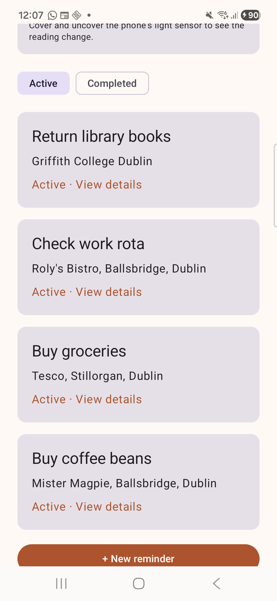
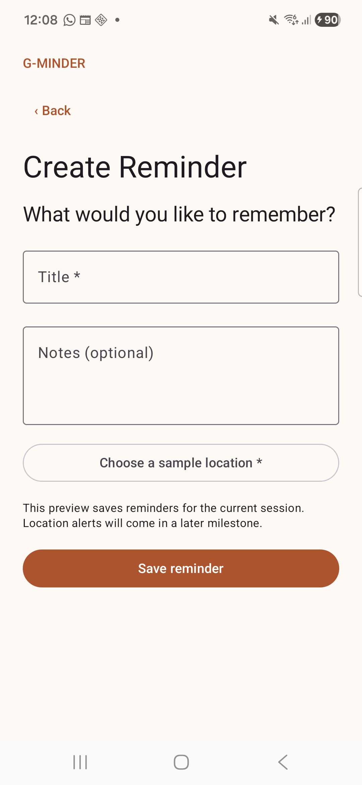
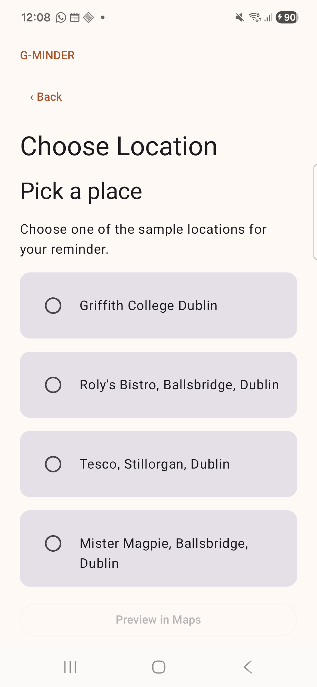
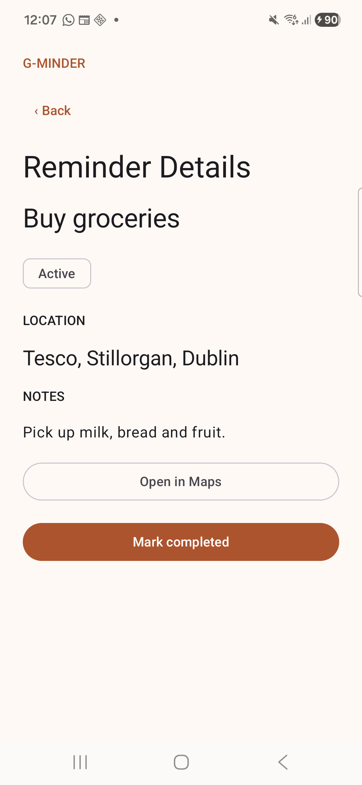

# G-Minder

An Android reminder app built with **Kotlin**, **Jetpack Compose** and **Material 3**. G-Minder connects everyday tasks with places, with a current prototype focused on reminder entry, navigation, Android intents and a theme that adapts to surrounding light.

## Current status

**Milestone 1 — interface and early functionality.** The app runs on a physical Samsung Android phone. Location selection currently uses predefined sample places; GPS monitoring, arrival detection and reminder notifications are planned.

## Features

- Four screens: My Reminders, Create Reminder, Choose Location and Reminder Details.
- Reminder entry with required-field validation and optional notes.
- Active and Completed filters, with completion updates returned from the details activity.
- An explicit Android intent that opens reminder details and passes task information.
- An implicit Maps intent that displays a selected place in a compatible installed app.
- A live ambient-light reading and optional automatic light/dark theme.
- Sensor availability checks and foreground lifecycle handling.
- Saved appearance preferences and small UI-state restoration.

The sample reminders cover college, work, groceries and buying coffee beans. Reminder records are currently held in UI state; permanent storage is not implemented yet.

## Screenshots

| My Reminders | Create Reminder | Choose Location | Reminder Details |
| --- | --- | --- | --- |
|  |  |  |  |

## Adaptive theme

The ambient-light sensor reports illuminance in lux. With **Adapt to surrounding light** enabled:

- Below **30 lux**, G-Minder selects its dark theme.
- Above **80 lux**, it selects its light theme.
- Between those thresholds, it retains the previous theme to reduce flickering.

Turning adaptation off selects the light theme. This changes the app's colour palette, rather than the phone's brightness setting. Devices without a light sensor can still use the reminder screens.

## Technology and structure

The [Milestone 1 design document](docs/g-minder%20Milestone%201.pdf) explains the scope, screen designs, navigation and implementation choices.

- Kotlin and Jetpack Compose
- Material 3 interface components
- Android activity-result APIs and explicit/implicit intents
- Android SensorManager and SensorEventListener
- SharedPreferences for appearance settings
- Gradle wrapper and version catalogue

```text
app/src/main/
  AndroidManifest.xml
  java/com/griffith/gminder/
    MainActivity.kt          Reminder model, screens, theme and Maps helper
    LightAwareActivity.kt    Shared sensor and adaptive-theme behaviour
    AmbientLightCard.kt      Reading display and adaptation switch
```

The first three screens use state-based navigation within MainActivity. ReminderDetailsActivity is a separate Android activity. Both inherit the shared light-sensor behaviour.

## Run locally

1. Clone this repository and open its root folder in Android Studio.
2. Install the SDK requested by the project and allow Gradle sync to finish.
3. Select the `app` configuration and an Android device or emulator with **API 24 or later**.
4. Run the app. A physical device with an ambient-light sensor is useful for testing the adaptive theme.

The project currently compiles and targets API 37. Android Studio's bundled JDK was used for development. Machine-specific SDK paths are excluded from version control.

An optional command-line build, with a suitable JDK and Android SDK configured:

```powershell
.\gradlew.bat :app:assembleDebug
```

The debug APK is generated under `app/build/outputs/apk/debug/`.

## Validation

The project has been built and run on a physical Samsung Android phone. Manual checks confirmed reminder creation, Maps opening and completion updates. The personalised place list and screen navigation have also been checked on the device. An automated test suite has not yet been added.

## Planned development

- GPS/location selection, geofencing and reminder notifications
- Permanent reminder storage
- A local profile and first-launch introduction
- Optional fingerprint or device-unlock protection
- A Settings card and hamburger menu for secondary features
- Broader accessibility, lifecycle and device testing

These items describe future work and are not presented as current features.

## Project context

Developed as a staged Mobile Development project at Griffith College Dublin. This repository preserves the implementation history and will evolve alongside later milestones.

**Project author:** Carlos David Urra Cabello
