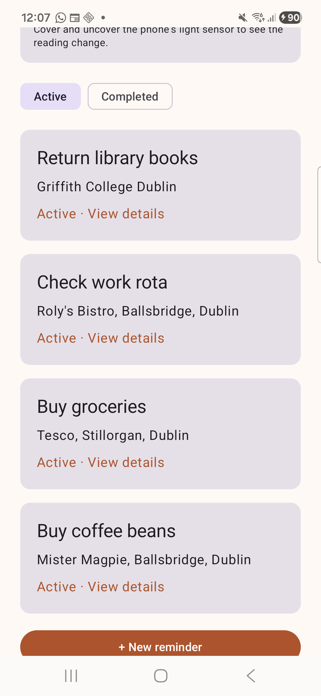
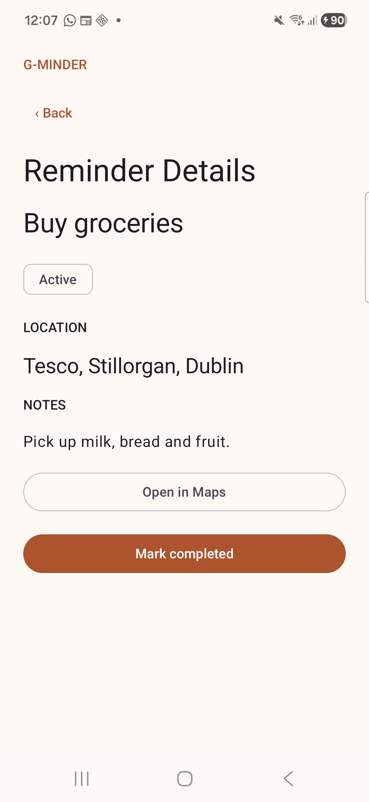

# G-Minder

An Android reminder app built with **Kotlin**, **Jetpack Compose** and **Material 3**. G-Minder connects everyday tasks with places, with a current prototype focused on reminder entry, navigation, Android intents and a theme that adapts to surrounding light.

## Current status

**Milestone 2 — in development.** The Milestone 1 interface is extended with Home, Settings and optional foreground location capture. Foreground arrival checks now show in-app alerts. Background monitoring and system notifications remain planned.

The local design preview adds a first-use welcome, a local display-name profile and a navigation drawer. This profile is not authentication: it has no password, identity verification, sync or security lock. Google sign-in remains planned for Milestone 3.

**Milestone 2 preparation — sensor reliability.** The light-sensor callback now safely ignores missing readings. The theme decision is isolated for automated checks covering invalid readings, threshold boundaries and fluctuating light levels. Foreground arrival checks also validate location age and reported accuracy.

**Settings** and **My profile** are available through the hamburger menu, alongside Home, My reminders and About G-Minder. Settings contains a compact automatic-theme switch with light/theme status, and a reminder-radius slider.

The adaptation control uses a full-width, labelled switch row with a minimum 48 dp height. Users can tap its label or switch, and accessibility services receive a single switch control. Status text distinguishes automatic mode being off, waiting for a reading, an unavailable sensor and unsupported hardware.

## Features

- Welcome and local-profile setup, followed by Home, My Reminders, Create Reminder, Choose Location, Pin on Map, Reminder Details, My profile, Settings and About.
- First launch shows a welcome screen and local profile setup. A saved profile opens Home on subsequent launches; its name can be edited through My profile.
- Home uses a centred greeting, six minimalist outline activity shortcuts without visible labels, active/completed count cards and one main New reminder button. Icon shortcuts fill the task title; all have accessibility descriptions.
- Reminder entry with required-field validation and optional notes.
- Active and Completed filters, with completion updates returned from the details activity.
- An explicit Android intent that opens reminder details and passes task information.
- An implicit Maps intent that displays a selected place in a compatible installed app.
- A live ambient-light reading and optional automatic light/dark theme.
- Optional current-location capture when choosing a reminder's place, with approximate/precise permission support, reported accuracy and Maps preview.
- An interactive map picker: pan, zoom, tap to drop or move a pin, then confirm its coordinates for the reminder.
- Sensor availability checks and foreground lifecycle handling.
- Saved appearance preferences and small UI-state restoration.
- A saved global reminder radius from 100 m to 1 km in 100 m steps (default 200 m). This range is used by the foreground Nearby reminders feature.

The app starts with an empty reminder list. Create reminders using place search, a map pin or captured current coordinates; preset sample locations and prefilled demonstration reminders have been removed. Saved reminders are stored locally using Room and SQLite.

## Local reminder database

Room stores each reminder's ID, title, notes, confirmed coordinates, completion status and creation time in the app-private `reminders.db` database. Both Details and arrival-alert completion actions update this database. Reactive queries refresh reminder lists, Home counts and eligible arrival targets after changes. Database reads and writes run asynchronously; save controls prevent repeated taps, and failures show a retryable error without discarding the form.

Saved reminders survive process termination and phone restarts. Settings and the local profile name continue to use SharedPreferences. Unsubmitted form drafts remain temporary. No account, cloud service or internet connection is needed for local storage; place search and online map tiles still need internet. Clearing app data or uninstalling can remove locally stored reminders.

Schema version 1 is exported under `app/schemas` for future migrations. Destructive migration fallback is not enabled. Earlier builds did not have permanent reminder storage to migrate. Monitoring starts off in a new process even though reminder records are restored; background alerts and cloud sync remain later work.

Verification on 25 November 2026: all 42 JVM tests passed, alongside three on-device Room tests covering file close/reopen, completion/reactivation, duplicate-ID protection, empty state and ordering. The normal handset flow also saved a grocery reminder with notes and a Tesco map location, retained it after force-stop/relaunch, and retained its completed status after a second force-stop/relaunch. A physical phone reboot and storage-failure recovery have not been tested.

## Place search

From **New reminder → Choose a location → Search places or pin on map**, enter a business name or address and tap **Search places**. Adding the town (for example, **Tesco Stillorgan Dublin**) helps distinguish branches. Select a result to centre the map and place a pin, adjust it by tapping if needed, then confirm **Use pinned location**. The reminder uses the confirmed coordinates for arrival checks.

Search uses [Photon](https://github.com/komoot/photon), based on OpenStreetMap data, with up to eight named results and their addresses. No result is automatically selected, including a single match. Results remain visible after choosing one, allowing branch comparison and another selection. The final map confirmation remains explicit. Only submitted search text is sent to photon.komoot.io; typing and phone coordinates are not sent to the search service. Mobile data or Wi-Fi is needed; no search API key or location permission is required.

HTTPS requests run on a background worker, with connection/read deadlines and a 15-second UI timeout. Cancellation and request identifiers prevent stale responses from replacing newer input. Up to twenty queries are cached for the life of the screen and uncached requests are spaced by at least 1.2 seconds. No-results and connection errors leave manual map selection available. The public Photon demo permits reasonable project usage but has no availability guarantee; a distributed production release should use a suitable hosted or private service. Coverage and ranking are not guaranteed, so users should inspect addresses and pins rather than assume the first result is correct.

Automated parser checks cover separate branches, named businesses at the same coordinate, address-only results, longitude/latitude ordering, invalid geometry, duplicates, result limits and malformed responses. Map script checks cover search centring, pin reuse, invalid coordinates and manual adjustment after search.

Handset verification on 25 November 2026 confirmed eight explicit choices for **Tesco Dublin**, retaining the list after selection and allowing another branch to be selected with a map pin preview. **Tesco Stillorgan** returned the Tesco and Tesco Off License entries on Old Dublin Road. These results depend on current provider coverage; a query can legitimately return one or no matches. Offline and timeout recovery have not yet been tested on the handset.

## Nearby reminders

Open the hamburger menu, select **Nearby reminders** and enable **Check nearby reminders**. Only active reminders with confirmed coordinates are eligible, whether chosen through search, a map pin or current-location capture. A fresh position is compared with each destination using a Haversine distance and the radius saved in Settings.

An arrival qualifies only when the reading is at most 30 seconds old and the distance plus its reported accuracy is within the chosen radius. Missing or broad accuracy readings do not trigger alerts. This conservative check reduces false arrivals but cannot guarantee positioning accuracy. The page shows live distances, reported accuracy and permission/provider status.

Alerts appear inside G-Minder with **Mark completed** and **Later** actions. Multiple arrivals queue, and each shown reminder alerts once per monitoring session. Retrying GPS, changing screens and rotating do not reset the session; switching checks off and on does. Completing/removing a reminder removes it from monitoring, and changing its destination makes it eligible for a new arrival. A task reactivated after completion can also alert again.

Location updates are opt-in and stop when MainActivity is no longer visible (including Maps, Details, switching apps or locking the phone). They resume on return if checks remain enabled. ViewModel state preserves the monitoring session across configuration changes; a new process starts with checks off and reloads saved reminders from Room. No background permission, foreground service, wake lock or system-notification permission is used. This is foreground arrival detection, not background geofencing.

Unit tests cover distance geometry, accuracy/freshness limits, target eligibility, duplicate suppression, range changes, changed destinations and unseen queued alerts. Physical GPS/provider/permission/lifecycle checks must be reported separately from these deterministic tests.

## Branding

G-Minder's vector mark combines a location pin with a checkmark. The orange mark is used on light backgrounds and a cream version on dark backgrounds. The welcome and Home screens share the same vector shape. Android launcher resources include a legacy icon, adaptive icon and monochrome layer for supported themed launchers.

Editable SVG files and the light/dark preview are in [`docs/branding`](docs/branding).

## Screenshots

These are Milestone 1 reference screenshots. The current local Home and menu design has since changed.

| My Reminders | Create Reminder | Choose Location | Reminder Details |
| --- | --- | --- | --- |
|  |  |  |  |

## Adaptive theme

The ambient-light sensor reports illuminance in lux. With **Adapt to surrounding light** enabled:

- Below **30 lux**, G-Minder selects its dark theme.
- Above **80 lux**, it selects its light theme.
- Between those thresholds, it retains the previous theme to reduce flickering.

Turning adaptation off selects the light theme. This changes the app's colour palette, rather than the phone's brightness setting. Devices without a light sensor can still use the reminder screens.

## Current-location capture

From **New reminder → Choose a location**, tap **Use my current location**. Android asks for foreground location permission only when needed; approximate access is supported. A request stops after the first valid reading, after 20 seconds, when cancelled, when leaving the selection screen, or when the app leaves the foreground. Readings older than 30 seconds are ignored.

Review the coordinates and reported accuracy, tap **Select these coordinates**, then **Preview in Maps** or **Use this location**. Coordinates are saved to Room when the reminder is saved. Opening Maps sends the selected place to the chosen maps app. No background location permission, API key or account is required.

Physical-device checks still needed for this increment: allow precise access, allow approximate access, deny access, disable phone location services, cancel a request, leave the screen during capture, and save/reopen a reminder with captured coordinates. The new local tests cover coordinate ranges, freshness, accuracy handling and locale-independent Maps formatting; they do not simulate a GPS fix or permission dialogs.

## Map pin selection

Open **Choose a location → Pin a location on map**. Move or zoom the map, tap the desired place and press **Use pinned location**. The choice returns to location selection, where **Use this location** returns it to the reminder form. Back cancels the map choice without replacing the previously selected place. A previous coordinate selection or captured location centres the map; otherwise it starts in Dublin. The initial centre is not automatically selected.

Map selection does not request GPS permission. Map imagery needs internet. The app bundles Leaflet 1.9.4 locally (BSD licence in `app/src/main/assets/map/LEAFLET-LICENSE.txt`) and uses OpenStreetMap's standard tiles with visible attribution, an identifying app User-Agent and normal WebView caching. It does not prefetch or download offline map areas. Tile requests reveal the viewed map area to the tile provider. See [Leaflet](https://leafletjs.com/examples-v1/quick-start/) and the [OpenStreetMap tile usage policy](https://operations.osmfoundation.org/policies/tiles/).

The map WebView only loads bundled map resources and HTTPS tile images, blocks external navigation inside the view, and validates coordinates received from its JavaScript bridge. The map is destroyed when leaving its screen. Explicit viewport sizing fixes a zero-height map observed in Android's scrolling layout. Map rendering and tap-to-pin coordinates have been checked on the Samsung phone. Offline behaviour and rotation restoration still need handset checks. Background alerts remain planned.

`node tools/test-map-picker.cjs` checks the picker script's map-event/Android-bridge contract using a small Leaflet test double. It covers initial selection, moving a single pin, longitude wrapping, tile feedback and selection restoration; it does not render tiles or test WebView itself.

An isolated browser render of the bundled page also loaded real tiles and checked that two map-selection events produced one moved pin and the expected coordinates. This does not replace the pending Android WebView handset tests.

## Technology and structure

The [Milestone 1 design document](docs/g-minder%20Milestone%201.pdf) explains the scope, screen designs, navigation and implementation choices.

- Kotlin and Jetpack Compose
- Material 3 interface components
- Android activity-result APIs and explicit/implicit intents
- Android SensorManager and SensorEventListener
- SharedPreferences for appearance settings
- Gradle wrapper and version catalogue

```text
app/src/main/
  AndroidManifest.xml
  java/com/griffith/gminder/
    MainActivity.kt          Reminder model, navigation and Maps helper
    Color.kt                 Light and dark colour schemes
    Theme.kt                 Shared theme and readable typography
    ReminderRange.kt         Radius defaults, limits and step validation
    ArrivalSession.kt        Distance, accuracy and once-per-session rules
    ForegroundArrivalMonitor.kt  Lifecycle-controlled Android location updates
    NearbyScreen.kt          Monitoring controls and live distances
    LightAwareActivity.kt    Shared sensor and adaptive-theme behaviour
    AmbientLightTheme.kt     Testable light-to-theme thresholds
    SettingsScreen.kt        Appearance controls and preview information
    HomeScreen.kt            Reminder overview and navigation shortcuts
    WelcomeScreen.kt         First-use introduction and local profile form
    LocalProfile.kt          Display-name validation
    AppDrawer.kt             Navigation menu and About screen
    ActivityIcons.kt         Native outline icons and activity shortcuts
    AmbientLightCard.kt      Reading display and adaptation switch
    CurrentLocationCapture.kt  Permission checks, fresh location requests and cleanup
    CurrentLocationCard.kt     Location capture and selection controls
    LocationFix.kt             Coordinate validation and Maps formatting
    MapLocationPicker.kt       Embedded map, pin selection and WebView lifecycle
  assets/map/                 Bundled Leaflet, picker page and third-party licence
```

Home, My Reminders, creation, location and settings use state-based navigation within MainActivity. Both the on-screen Back button and Android Back return from location selection to the form, from the form to the reminders list, and from the reminders list to Home. ReminderDetailsActivity is a separate Android activity. Both activities inherit the shared light-sensor behaviour.

## Run locally

1. Clone this repository and open its root folder in Android Studio.
2. Install the SDK requested by the project and allow Gradle sync to finish.
3. Select the `app` configuration and an Android device or emulator with **API 24 or later**.
4. Run the app and complete the first-use local profile. A physical device with an ambient-light sensor is useful for testing the adaptive theme.

The project currently compiles and targets API 37. Android Studio's bundled JDK was used for development. Machine-specific SDK paths are excluded from version control.

If a synced folder such as OneDrive locks generated build files on Windows, add `gminder.buildRoot=C\:/Users/YOUR_USER/AppData/Local/G-Minder/build` to the untracked `local.properties` file, then sync Gradle. This relocates generated output only. Without this optional property, Gradle uses its usual project build folders.

An optional command-line build, with a suitable JDK and Android SDK configured:

```powershell
.\gradlew.bat :app:assembleDebug
```

The debug APK is generated under `app/build/outputs/apk/debug/`.

## Validation

The local welcome/Home preview has been rendered on the Samsung phone. Empty profile names are blocked, creating the local Carlos profile opens Home, and all six icon shortcuts expose meaningful accessibility descriptions without visible labels. Each shortcut was checked against its suggested reminder title. Drawer routes to Settings, My profile, My reminders and About work; profile saving and introduction preview were checked, and restarting the app restored the profile directly to Home.

The Settings radius is saved to SharedPreferences when the slider gesture finishes and restored on the next app launch. Unit tests check the supported values, rounding and invalid saved values. The radius describes distance from the selected point, not a circle's circumference. It controls foreground arrival checks; it does not enable background or system notifications.

On the Samsung phone, changing the slider to 700 m and restarting the app restored 700 m correctly. It was then returned to the 200 m default.

Milestone 1 feedback informed the current layout: sensor controls moved into Settings, duplicate introduction text removed from My Reminders, body text standardised to 16 sp with 14 sp supporting text, and colour schemes/theme extracted into separate files. Text remains scalable through Android's font setting. New milestone documentation should prioritise behaviour, navigation and testing over extended colour-choice explanations; the next demo can show only the app screen.

The project has been built and run on a physical Samsung Android phone. Manual checks confirmed reminder creation, Maps opening and completion updates. The personalised place list and screen navigation have also been checked on the device. Local unit tests cover the light-to-theme decisions, including invalid readings and hysteresis. These tests do not replace physical sensor and lifecycle checks.

Run the local tests with `./gradlew :app:testDebugUnitTest` (or `.\gradlew.bat :app:testDebugUnitTest` on Windows).

## Planned development

- Background location monitoring, geofencing and reminder notifications
- Optional fingerprint or device-unlock protection
- Google sign-in and account synchronisation (Milestone 3)
- Broader accessibility, lifecycle and device testing

These items describe future work and are not presented as current features.

## Project context

Developed as a staged Mobile Development project at Griffith College Dublin. This repository preserves the implementation history and will evolve alongside later milestones.

**Project author:** Carlos David Urra Cabello
