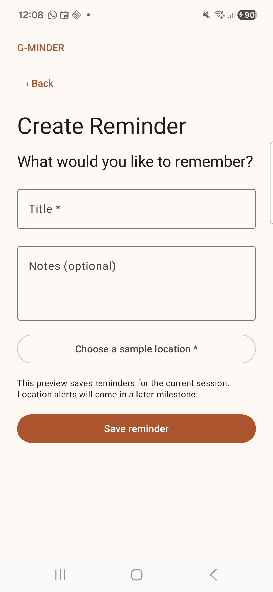
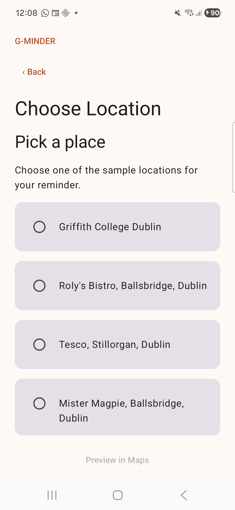

# G-Minder

An Android reminder app built with **Kotlin**, **Jetpack Compose** and **Material 3**. G-Minder connects everyday tasks with places, with a current prototype focused on reminder entry, navigation, Android intents and a theme that adapts to surrounding light.

## Current status

**Milestone 2 — in development.** The Milestone 1 interface is extended with Home, Settings and optional foreground location capture. Background monitoring, arrival detection and reminder notifications are planned.

**Milestone 2 preparation — sensor reliability.** The light-sensor callback now safely ignores missing readings. The theme decision is isolated for automated checks covering invalid readings, threshold boundaries and fluctuating light levels. This is an incremental improvement to the existing sensor feature; location-triggered reminders remain planned.

**Settings** is available from Home and My Reminders. It contains a compact automatic-theme switch with light/theme status, and a reminder-radius slider. Home and My Reminders focus on task navigation and reminder cards.

The adaptation control uses a full-width, labelled switch row with a minimum 48 dp height. Users can tap its label or switch, and accessibility services receive a single switch control. Status text distinguishes automatic mode being off, waiting for a reading, an unavailable sensor and unsupported hardware.

## Features

- Seven screens: Home, My Reminders, Create Reminder, Choose Location, Pin on Map, Reminder Details and Settings.
- Home opens first and shows live active/completed counts, shortcuts to each filtered list, reminder creation and Settings. Counts update when reminders are created or completed.
- Reminder entry with required-field validation and optional notes.
- Active and Completed filters, with completion updates returned from the details activity.
- An explicit Android intent that opens reminder details and passes task information.
- An implicit Maps intent that displays a selected place in a compatible installed app.
- A live ambient-light reading and optional automatic light/dark theme.
- Optional current-location capture when choosing a reminder's place, with approximate/precise permission support, reported accuracy and Maps preview.
- An interactive map picker: pan, zoom, tap to drop or move a pin, then confirm its coordinates for the reminder.
- Sensor availability checks and foreground lifecycle handling.
- Saved appearance preferences and small UI-state restoration.
- A saved global reminder radius from 100 m to 1 km in 100 m steps (default 200 m). This is configuration for future arrival detection; automatic arrival alerts are not implemented yet.

The sample reminders cover college, work, groceries and buying coffee beans. Reminder records are currently held in UI state; permanent storage is not implemented yet.

## Screenshots

| My Reminders | Create Reminder | Choose Location | Reminder Details |
| --- | --- | --- | --- |
|  |  |  |  |

## Adaptive theme

The ambient-light sensor reports illuminance in lux. With **Adapt to surrounding light** enabled:

- Below **30 lux**, G-Minder selects its dark theme.
- Above **80 lux**, it selects its light theme.
- Between those thresholds, it retains the previous theme to reduce flickering.

Turning adaptation off selects the light theme. This changes the app's colour palette, rather than the phone's brightness setting. Devices without a light sensor can still use the reminder screens.

## Current-location capture

From **New reminder → Choose a location**, tap **Use my current location**. Android asks for foreground location permission only when needed; approximate access is supported. A request stops after the first valid reading, after 20 seconds, when cancelled, when leaving the selection screen, or when the app leaves the foreground. Readings older than 30 seconds are ignored.

Review the coordinates and reported accuracy, tap **Select these coordinates**, then **Preview in Maps** or **Use this location**. Saving uses the existing reminder flow; coordinates remain session data. Opening Maps sends the selected place to the chosen maps app. No background location permission, API key, account or new location-service dependency is required.

Physical-device checks still needed for this increment: allow precise access, allow approximate access, deny access, disable phone location services, cancel a request, leave the screen during capture, and save/reopen a reminder with captured coordinates. The new local tests cover coordinate ranges, freshness, accuracy handling and locale-independent Maps formatting; they do not simulate a GPS fix or permission dialogs.

## Map pin selection

Open **Choose a location → Pin a location on map**. Move or zoom the map, tap the desired place and press **Use pinned location**. The choice returns to location selection, where **Use this location** returns it to the reminder form. Back cancels the map choice without replacing the previously selected place. A previous coordinate selection or captured location centres the map; otherwise it starts in Dublin. The initial centre is not automatically selected.

Map selection does not request GPS permission. Map imagery needs internet. The app bundles Leaflet 1.9.4 locally (BSD licence in `app/src/main/assets/map/LEAFLET-LICENSE.txt`) and uses OpenStreetMap's standard tiles with visible attribution, an identifying app User-Agent and normal WebView caching. It does not prefetch or download offline map areas. Tile requests reveal the viewed map area to the tile provider. See [Leaflet](https://leafletjs.com/examples-v1/quick-start/) and the [OpenStreetMap tile usage policy](https://operations.osmfoundation.org/policies/tiles/).

The map WebView only loads bundled map resources and HTTPS tile images, blocks external navigation inside the view, and validates coordinates received from its JavaScript bridge. The map is destroyed when leaving its screen. Explicit viewport sizing fixes a zero-height map observed in Android's scrolling layout. Map rendering and tap-to-pin coordinates have been checked on the Samsung phone. Offline behaviour and rotation restoration still need handset checks. Arrival alerts remain planned.

`node tools/test-map-picker.cjs` checks the picker script's map-event/Android-bridge contract using a small Leaflet test double. It covers initial selection, moving a single pin, longitude wrapping, tile feedback and selection restoration; it does not render tiles or test WebView itself.

An isolated browser render of the bundled page also loaded real tiles and checked that two map-selection events produced one moved pin and the expected coordinates. This does not replace the pending Android WebView handset tests.

## Technology and structure

The [Milestone 1 design document](docs/g-minder%20Milestone%201.pdf) explains the scope, screen designs, navigation and implementation choices.

- Kotlin and Jetpack Compose
- Material 3 interface components
- Android activity-result APIs and explicit/implicit intents
- Android SensorManager and SensorEventListener
- SharedPreferences for appearance settings
- Gradle wrapper and version catalogue

```text
app/src/main/
  AndroidManifest.xml
  java/com/griffith/gminder/
    MainActivity.kt          Reminder model, navigation and Maps helper
    Color.kt                 Light and dark colour schemes
    Theme.kt                 Shared theme and readable typography
    ReminderRange.kt         Radius defaults, limits and step validation
    LightAwareActivity.kt    Shared sensor and adaptive-theme behaviour
    AmbientLightTheme.kt     Testable light-to-theme thresholds
    SettingsScreen.kt        Appearance controls and preview information
    HomeScreen.kt            Reminder overview and navigation shortcuts
    AmbientLightCard.kt      Reading display and adaptation switch
    CurrentLocationCapture.kt  Permission checks, fresh location requests and cleanup
    CurrentLocationCard.kt     Location capture and selection controls
    LocationFix.kt             Coordinate validation and Maps formatting
    MapLocationPicker.kt       Embedded map, pin selection and WebView lifecycle
  assets/map/                 Bundled Leaflet, picker page and third-party licence
```

Home, My Reminders, creation, location and settings use state-based navigation within MainActivity. Both the on-screen Back button and Android Back return from location selection to the form, from the form to the reminders list, and from the reminders list to Home. ReminderDetailsActivity is a separate Android activity. Both activities inherit the shared light-sensor behaviour.

## Run locally

1. Clone this repository and open its root folder in Android Studio.
2. Install the SDK requested by the project and allow Gradle sync to finish.
3. Select the `app` configuration and an Android device or emulator with **API 24 or later**.
4. Run the app. A physical device with an ambient-light sensor is useful for testing the adaptive theme.

The project currently compiles and targets API 37. Android Studio's bundled JDK was used for development. Machine-specific SDK paths are excluded from version control.

An optional command-line build, with a suitable JDK and Android SDK configured:

```powershell
.\gradlew.bat :app:assembleDebug
```

The debug APK is generated under `app/build/outputs/apk/debug/`.

## Validation

The Settings radius is saved to SharedPreferences when the slider gesture finishes and restored on the next app launch. Unit tests check the supported values, rounding and invalid saved values. The radius describes distance from the selected point, not a circle's circumference. It currently configures future arrival logic and does not trigger a notification.

On the Samsung phone, changing the slider to 700 m and restarting the app restored 700 m correctly. It was then returned to the 200 m default.

Milestone 1 feedback informed the current layout: sensor controls moved into Settings, duplicate introduction text removed from My Reminders, body text standardised to 16 sp with 14 sp supporting text, and colour schemes/theme extracted into separate files. Text remains scalable through Android's font setting. New milestone documentation should prioritise behaviour, navigation and testing over extended colour-choice explanations; the next demo can show only the app screen.

The project has been built and run on a physical Samsung Android phone. Manual checks confirmed reminder creation, Maps opening and completion updates. The personalised place list and screen navigation have also been checked on the device. Local unit tests cover the light-to-theme decisions, including invalid readings and hysteresis. These tests do not replace physical sensor and lifecycle checks.

Run the local tests with `./gradlew :app:testDebugUnitTest` (or `.\gradlew.bat :app:testDebugUnitTest` on Windows).

## Planned development

- Background location monitoring, geofencing and reminder notifications
- Permanent reminder storage
- A local profile and first-launch introduction
- Optional fingerprint or device-unlock protection
- A navigation menu for secondary features as the app grows
- Broader accessibility, lifecycle and device testing

These items describe future work and are not presented as current features.

## Project context

Developed as a staged Mobile Development project at Griffith College Dublin. This repository preserves the implementation history and will evolve alongside later milestones.

**Project author:** Carlos David Urra Cabello
